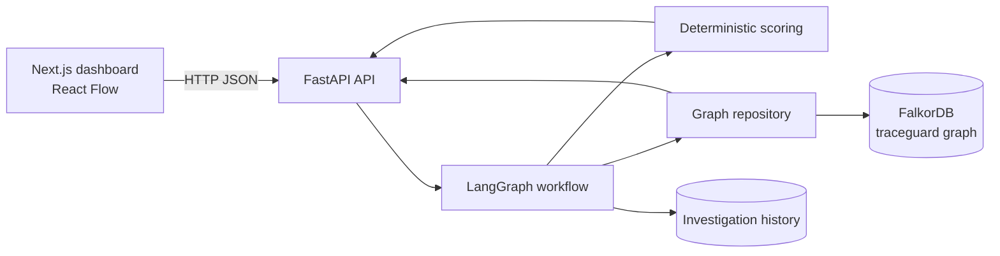

# TraceGuard

TraceGuard is an explainable threat-investigation dashboard for Graph Hacks 2026. It uses deterministic synthetic security telemetry to trace relationships between alerts, accounts, devices, IP addresses, and threat indicators in FalkorDB. A typed LangGraph workflow turns those graph results into transparent risk factors, evidence findings, recommendations, and persisted investigation history.

> **Synthetic, non-production telemetry:** all alerts, identities, addresses, devices, indicators, and investigation results in the seeded graph are fictional. TraceGuard is a hackathon demonstration and is not a production detection or incident-response system.

## Features

- Searchable alert dashboard with severity filters and backend health status.
- Explainable investigation workflow with deterministic risk scoring.
- FalkorDB graph traversal across accounts, devices, IPs, and threat indicators.
- React Flow visualization of the selected alert's actual graph subgraph.
- Correlated-account and device analysis with shared-infrastructure caveats.
- Evidence-backed findings, recommendations, and investigation history.
- Graph statistics and development-only graph reseeding.
- FastAPI REST endpoints with interactive OpenAPI documentation.
- Optional OpenAI or Google explanation generation; deterministic explanations are the default.

## Problem And Motivation

Security alerts are easier to act on when an analyst can see the connected context instead of reviewing each alert in isolation. TraceGuard demonstrates a graph-first investigation pattern: retrieve structured relationships from FalkorDB, calculate a reproducible score from returned evidence, and present both supporting facts and uncertainty rather than hiding the reasoning behind an opaque model.

## How It Works

The investigation workflow is implemented in `backend/app/agents/workflow.py` and runs these stages:

1. Validate the alert exists.
2. Fetch the alert and its account context.
3. Traverse `Alert -> Account -> IP -> ThreatIndicator` paths.
4. Find related accounts and investigate connected devices.
5. Retrieve previous investigations.
6. Calculate the deterministic risk score.
7. Build findings only from returned graph evidence.
8. Generate a deterministic or optional LLM explanation.
9. Persist the investigation and its IOC evidence in FalkorDB.
10. Return the investigation and React Flow visualization data.

## Architecture



## Technology Stack

- Frontend: Next.js App Router, React, TypeScript, Tailwind CSS, `@xyflow/react`, Lucide icons.
- Backend: Python, FastAPI, Pydantic, Uvicorn.
- Workflow: LangGraph with deterministic fallback explanations and optional LangChain provider integrations.
- Graph database: FalkorDB over Redis-compatible graph queries.
- Tooling: `uv`, pytest, npm, and Docker Compose.

## Repository Structure

```text
.
├── backend/
│   ├── app/
│   │   ├── agents/       # Workflow and deterministic scoring
│   │   ├── api/          # FastAPI routes and response models
│   │   └── graph/        # FalkorDB connection, queries, seed data
│   ├── tests/             # Scoring, workflow, API, and repository tests
│   ├── Dockerfile
│   ├── pyproject.toml
│   ├── requirements.txt
│   └── uv.lock
├── frontend/
│   ├── app/               # Next.js app shell and dashboard page
│   ├── components/        # Alert, investigation, graph, and modal UI
│   ├── lib/api.ts         # Backend API client
│   ├── types/             # Frontend response types
│   ├── package.json
│   └── package-lock.json
├── .env.example
├── docker-compose.yml
└── README.md
```

Generated directories such as `backend/.venv`, `backend/.pytest_cache`, `frontend/node_modules`, and `frontend/.next` are local-only and are excluded by `.gitignore`.

## Prerequisites

On Windows, install Docker Desktop with Linux containers enabled, Python supported by the backend dependencies, [`uv`](https://docs.astral.sh/uv/), and Node.js with npm compatible with the installed Next.js version.

## Configuration

Copy the root example configuration and edit only the values needed for your environment:

```powershell
Copy-Item .env.example .env
```

The backend reads:

| Variable | Default | Purpose |
|---|---|---|
| `FALKORDB_HOST` | `localhost` | FalkorDB host for local backend runs; Compose uses `falkordb`. |
| `FALKORDB_PORT` | `6379` | FalkorDB Redis-compatible port. |
| `GRAPH_NAME` | `traceguard` | FalkorDB named graph. |
| `LLM_PROVIDER` | `deterministic` | `deterministic`, `openai`, or `google`. |
| `OPENAI_API_KEY` | empty | Optional provider key; never commit a real key. |
| `GOOGLE_API_KEY` | empty | Optional provider key; never commit a real key. |
| `OPENAI_MODEL` | `gpt-4o-mini` | Optional OpenAI model. |
| `GOOGLE_MODEL` | `gemini-1.5-flash` | Optional Google model. |
| `LOG_LEVEL` | `INFO` | Backend logging level. |

For the frontend:

```powershell
Copy-Item frontend\.env.local.example frontend\.env.local
```

`NEXT_PUBLIC_API_URL` controls the browser-facing backend URL and defaults to `http://127.0.0.1:8000` in the example configuration.

## Windows PowerShell Setup

### 1. Start FalkorDB

From the project root, start only the database for local development:

```powershell
cd C:\Graph-Hacks-Hackathon
docker compose up -d falkordb
```

The Compose file also defines a backend service. Starting `docker compose up -d` runs that service in a container, while the local backend instructions below run Uvicorn directly. Use one backend mode at a time. The Compose file maps FalkorDB's optional web UI to host port `3000`, so running the local Next.js development server on port `3000` is simplest when only the `falkordb` service is started.

### 2. Install and start the backend

```powershell
cd C:\Graph-Hacks-Hackathon\backend
uv venv
uv pip install -r requirements.txt
uv run uvicorn app.main:app --reload --port 8000
```

On startup, the backend connects to FalkorDB and initializes the deterministic seed graph if it has not already been initialized.

### 3. Install and start the frontend

In a second PowerShell terminal:

```powershell
cd C:\Graph-Hacks-Hackathon\frontend
npm install
npm run dev
```

Open the dashboard at [http://localhost:3000](http://localhost:3000/).

### Compose backend alternative

To run the backend in Docker instead of local Uvicorn:

```powershell
cd C:\Graph-Hacks-Hackathon
docker compose up -d falkordb backend
```

Do not also start the local backend on port `8000`. The backend container mounts `./backend` at `/app` and uses the Compose service name `falkordb` for its database host.

## API

With the backend running:

- Health: [http://127.0.0.1:8000/health](http://127.0.0.1:8000/health)
- OpenAPI UI: [http://127.0.0.1:8000/docs](http://127.0.0.1:8000/docs)
- Alerts: `GET /api/alerts`
- Alert context: `GET /api/alerts/{alert_id}`
- Investigation: `POST /api/investigate/{alert_id}`
- Investigation history: `GET /api/investigations/{alert_id}/history`
- Visualization data: `GET /api/visualize/{alert_id}`
- Graph statistics: `GET /api/graph/stats`
- Development reseed: `POST /api/graph/reseed`

The investigation endpoint returns the score, verdict, factors, uncertainties, findings, related accounts, devices, history, and visualization data in one response.

## Risk Scoring

The scorer in `backend/app/agents/scoring.py` is deterministic and additive. Current contributions include:

- Alert severity: 30 critical, 25 high, 15 medium, 5 low.
- IOC confidence: 30 high, 18 medium, or 8 low.
- IP reputation: 20 malicious or 8 suspicious.
- Compromised devices: 25 critical, 18 high, or 10 lower criticality.
- Suspicious devices: 10.
- Lateral-movement alert type: 12.
- Distinct multi-hop IP paths: 5 once.

Scores are capped at 100 and mapped to `CRITICAL` (80+), `HIGH` (60+), `MEDIUM` (35+), `LOW` (15+), or `BENIGN`. Multiple threat feeds on the same IP use the strongest IOC rather than being counted as independent endpoint evidence. Shared accounts and infrastructure are reported as caveats, not automatic compromise evidence.

## Example Investigation

`ALT-002` is the seeded `DataExfiltration` alert for `alice.morgan`. Its description mentions a 4.2 GB transfer, but the graph contains no `Alert -> Account -> IP -> ThreatIndicator` path for the account. The current investigation therefore scores only the critical alert severity and the connected high-criticality compromised device: `48 / 100`, `MEDIUM`. The findings explicitly state that no exfiltration endpoint or threat indicator was returned; the description is not treated as graph evidence.

`ALT-001` demonstrates a multi-hop case through a malicious IP and high-confidence threat intelligence. `ALT-005` demonstrates a low-severity, clean-telemetry case.

## Tests And Build Checks

Backend tests:

```powershell
cd C:\Graph-Hacks-Hackathon\backend
uv run --with pytest pytest -q
```

Frontend lint and production build:

```powershell
cd C:\Graph-Hacks-Hackathon\frontend
npm run lint
npm run build
```

Repository tests that query FalkorDB require a running database. They skip at runtime when the database cannot be reached.

## Limitations And Caveats

- The dataset is synthetic and deterministic; it is not evidence of real incidents.
- The score is a transparent heuristic, not a calibrated probability or production severity model.
- Optional LLM providers generate prose only; graph queries and risk scoring remain deterministic.
- The development reseed endpoint is exposed without authentication and should not be deployed publicly.
- There is no authentication, authorization, multi-user case management, or production secret-management layer.
- The frontend currently relies on the backend API and does not include a separate browser test suite.
- Local investigation runs persist history in the named FalkorDB graph, so repeated demonstrations add history records.

## Future Improvements

- Add authenticated analyst sessions and role-based access controls.
- Add calibrated scoring evaluation against a labelled dataset.
- Add browser-level regression tests for alert selection and graph rendering.
- Add richer event-time and relationship provenance to every finding.
- Add production deployment manifests, observability, and managed secret configuration.

## License

No project license file or explicit license configuration is currently present. Add a license before distributing TraceGuard beyond the hackathon repository.
